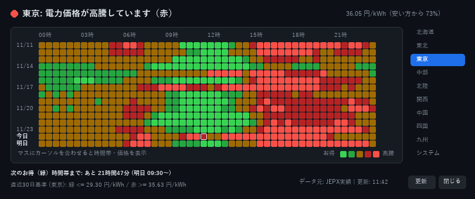
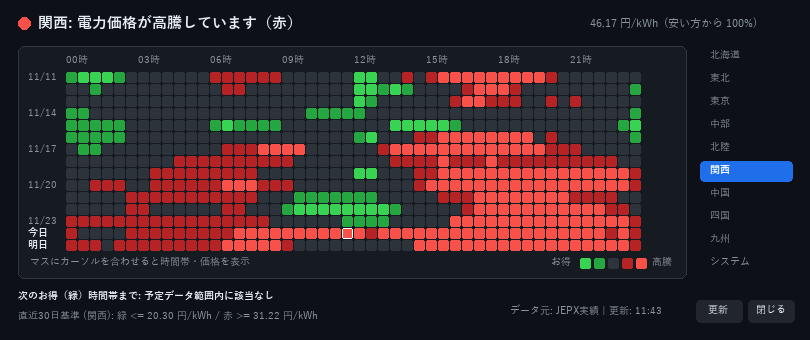
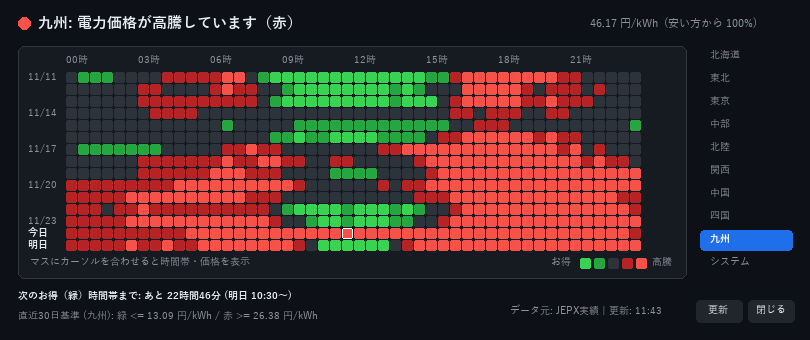
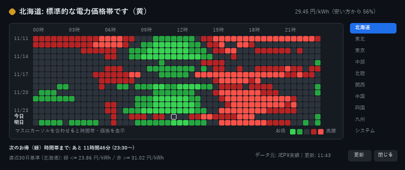

# GPU電力シグナル (JEPX GPU Signal)

今が GPU タスクを回すのに「お得な時間帯（緑）」か「高騰している時間帯（赤）」かを、Windows タスクトレイアイコンと GitHub コントリビューショングラフ風のヒートマップでひと目で確認できる常駐アプリです。

## 特徴

- **地域差を吸収する相対判定**: 固定の円/kWh 閾値ではなく、選択したエリアの **直近30日間の価格分布（パーセンタイル）** を基準に判定します（安い方から 30% 以下＝緑、中間＝黄、上位 30% 以上＝赤）。
- **JEPX 公式スポット価格を自動取得**: 日本卸電力取引所（JEPX）の公開スポット市場 CSV を自動取得してローカルキャッシュします。オフライン時は統計傾向モデルへ自動フォールバックします。
- **GitHub 風ヒートマップ UI**: 直近14日＋当日（翌日公開後は翌日分も表示）× 48コマ（30分単位）の価格推移を可視化。次の「緑（お得）」／「赤（高騰）」時間帯までのカウントダウンも表示します。

## スクリーンショット

### 東京（東京エリア）


### 大阪（関西エリア）


### 熊本（九州エリア）


### 北海道（北海道エリア）


## セットアップと起動

```powershell
python -m venv .venv
.\.venv\Scripts\pip.exe install pystray pillow pytest
```

`launch.bat` をダブルクリックするか、以下で起動します。

```powershell
.\.venv\Scripts\pythonw.exe app.py
```

## CLI の使い方

ターミナルやバッチ処理からも同じ判定ロジックを利用できます。

```powershell
# 現在の判定を表示（デフォルトエリア）
.\.venv\Scripts\python.exe cli.py

# エリア指定 + 直近7日ヒートマップ表示
.\.venv\Scripts\python.exe cli.py --area 東京 --heatmap

# 全エリア一覧表示
.\.venv\Scripts\python.exe cli.py --all

# JSON 出力
.\.venv\Scripts\python.exe cli.py --area 九州 --json

# 自動化向け終了コード判定（緑=0, 標準=1, 赤=2）
.\.venv\Scripts\python.exe cli.py --area 北海道 --check
```

## テスト

```powershell
.\.venv\Scripts\pytest.exe -v
```
